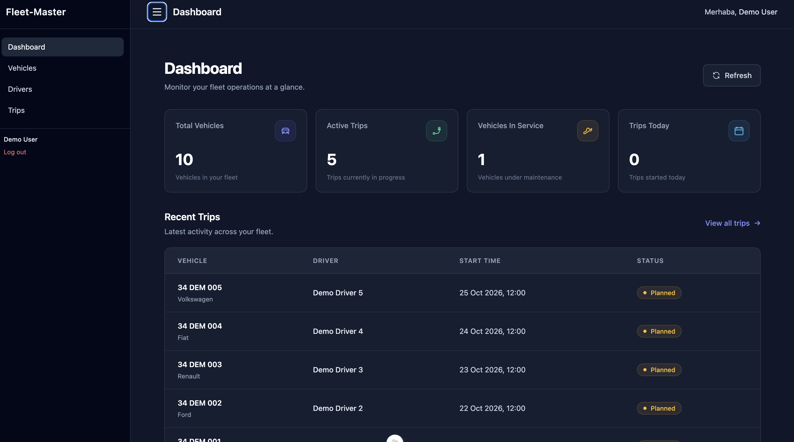
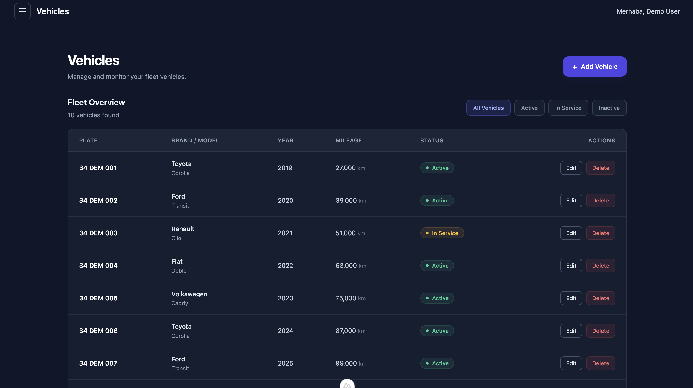
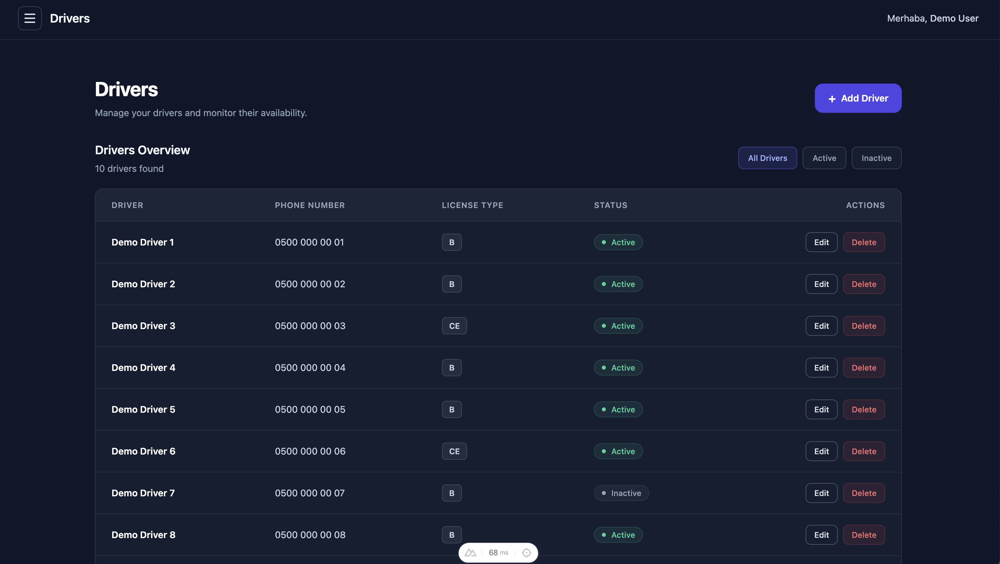
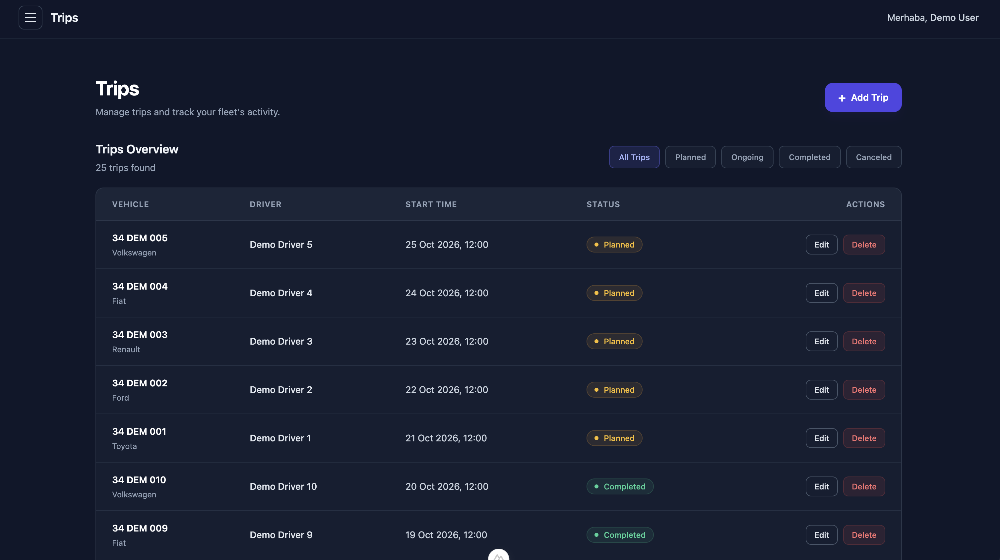

# Fleet-Master

**Fleet Management Dashboard | Laravel REST API & Nuxt.js**

Fleet-Master is a full-stack fleet management application designed to manage vehicles, drivers, and trips through a centralized dashboard.

The project combines a Laravel REST API with a Nuxt.js frontend, providing authenticated access, CRUD operations, filtering, and operational insights.

## Features

### Dashboard
- Overview of fleet operations and key metrics
- Summary of vehicles, drivers, and trips
- Interactive dashboard interface

### Vehicle Management
- Create, view, update, and delete vehicles
- Track vehicle information and operational status
- Filter vehicles by status

### Driver Management
- Create, view, update, and delete drivers
- Manage driver information and availability
- Filter drivers by status

### Trip Management
- Create, view, update, and delete trips
- Track trip details, including distance, duration, and costs
- Filter trips by status
- Paginated trip listings

### Authentication
- User authentication using Laravel Sanctum
- Protected API endpoints
- Login and logout functionality
- Login rate limiting

## Tech Stack

| Backend | Frontend | Database |
|---------|----------|----------|
| PHP | Nuxt 4 | PostgreSQL |
| Laravel 12 | Vue 3 | |
| Laravel Sanctum | Tailwind CSS | |

## Screenshots

### Dashboard


### Vehicles


### Drivers


### Trips


## Project Structure

```text
fleet-master/
├── backend/              # Laravel REST API
├── frontend/             # Nuxt.js application
├── docs/
│   └── screenshots/      # Application screenshots
└── README.md
```

## Getting Started

### Prerequisites

Make sure the following tools are installed:

- PHP 8.2+
- Composer
- Node.js and npm
- PostgreSQL

### 1. Clone the Repository

```bash
git clone https://github.com/Zehraatalay/fleet-master.git
cd fleet-master
```

### 2. Backend Setup

Navigate to the backend directory:

```bash
cd backend
```

Install PHP dependencies:

```bash
composer install
```

Create the environment configuration:

```bash
cp .env.example .env
php artisan key:generate
```

Configure the PostgreSQL connection in `backend/.env`:

```env
DB_CONNECTION=pgsql
DB_HOST=127.0.0.1
DB_PORT=5432
DB_DATABASE=fleet_master
DB_USERNAME=your_username
DB_PASSWORD=your_password
```

Create the PostgreSQL database if it does not already exist.

Run database migrations:

```bash
php artisan migrate
```

Populate the database with sample fleet data:

```bash
php artisan db:seed --class=DemoSeeder
```

Start the Laravel development server:

```bash
php artisan serve
```

The backend API will be available at:

`http://127.0.0.1:8000/api`

### 3. Create a Login User

The demo seeder populates fleet data but does not create a login account.

Open another terminal in the `backend` directory and run:

```bash
php artisan tinker
```

Create a local user:

```php
\App\Models\User::factory()->create([
    'name' => 'Demo User',
    'email' => 'demo@example.com',
    'password' => bcrypt('your-local-password'),
]);
```

Use the email and password you configured to sign in.

**Note:** The example credentials are placeholders. No production credentials are included in this repository.

### 4. Frontend Setup

Open a new terminal and navigate to the frontend directory from the project root:

```bash
cd frontend
```

Install dependencies:

```bash
npm ci
```

Create the frontend environment file:

```bash
cp .env.example .env
```

The frontend uses the following API base URL by default:

```env
NUXT_PUBLIC_API_BASE=http://127.0.0.1:8000/api
```

Start the development server:

```bash
npm run dev
```

Open the application at:

`http://localhost:3000`

## API Overview

The Laravel backend provides REST endpoints for fleet management.

| Resource | Operations |
|----------|------------|
| Authentication | Login, logout |
| Vehicles | List, create, view, update, delete |
| Drivers | List, create, view, update, delete |
| Trips | List, create, view, update, delete |
| Dashboard | Retrieve fleet summary data |

All fleet management endpoints require authentication through Laravel Sanctum.

## Testing

### Backend Tests

From the `backend` directory:

```bash
php artisan test
```

The backend includes feature tests for authentication and protected API access.

### Frontend Production Build

From the `frontend` directory:

```bash
npm run build
```

## Development Notes

- The application is designed as a local development and portfolio project.
- The backend and frontend are maintained as separate applications.
- Database credentials and environment-specific configuration are stored in `.env` files and excluded from version control.
- Sample fleet data can be generated using `DemoSeeder`.
- The frontend communicates with the Laravel backend through REST API requests.

## Project Status

**Completed — Portfolio MVP**

Core fleet management features, authentication, dashboard views, and database integration have been implemented.

The application has been tested locally and successfully builds for production. Additional security hardening and deployment configuration would be required before using it in a production environment.